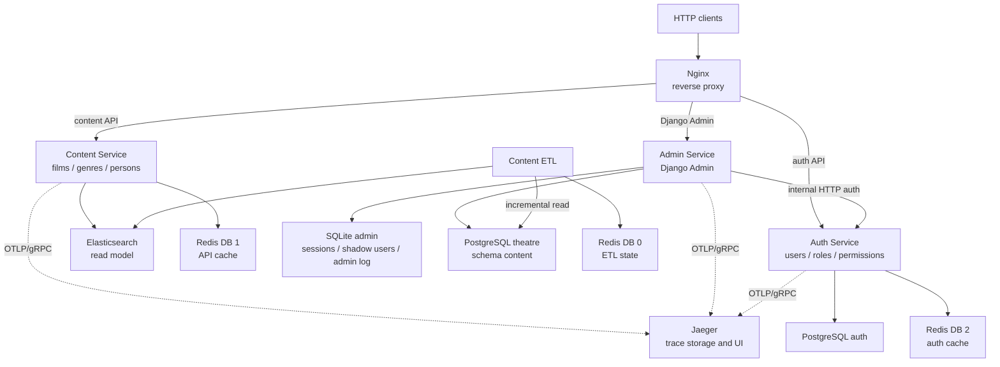

# Movies Backend

Backend онлайн-кинотеатра, оформленный как монорепозиторий из независимых сервисов.

Проект предоставляет:

- read-only API для фильмов, жанров и персон;
- Django Admin для управления контентом;
- сервис аутентификации и авторизации;
- инкрементальную синхронизацию данных PostgreSQL → Elasticsearch;
- кеширование ответов и хранение состояния ETL в Redis;
- единую точку входа для прикладных HTTP-сервисов через Nginx;
- распределённую трассировку HTTP-запросов через OpenTelemetry и Jaeger;
- изолированные функциональные тесты сервисов.

## Архитектура



`Nginx` является единственной внешней точкой входа для прикладных HTTP-сервисов и публикуется на `127.0.0.1:8000`. HTTP-сервисы доступны Nginx по внутренней Docker-сети и не публикуют собственные порты на хост.

`Admin Service` проверяет логин и пароль через `Auth Service` по внутреннему адресу `auth-service:8000`, а после успешного входа использует собственную Django-сессию. Контекст OpenTelemetry передаётся между этими сервисами автоматически через HTTP-заголовок `traceparent`.

Nginx назначает или сохраняет `X-Request-ID`, передаёт его backend-сервисам и возвращает клиенту. Сервисы сохраняют этот идентификатор в серверных spans, поэтому один запрос можно сопоставлять между Jaeger и Nginx access log.

Контентные модели Django подключены к существующим таблицам схемы `content` в PostgreSQL. Django не управляет структурой этих таблиц через миграции.

## Компоненты

| Компонент | Назначение |
| --- | --- |
| `nginx` | Единая точка входа и маршрутизация прикладных HTTP-запросов |
| `jaeger` | Приём, хранение и просмотр OpenTelemetry traces |
| `content-service` | Read-only FastAPI API для фильмов, жанров и персон |
| `admin-service` | Django Admin для управления фильмами, жанрами и персонами |
| `auth-service` | Аутентификация, авторизация, роли и permissions |
| `content-etl` | Инкрементальный перенос данных PostgreSQL → Elasticsearch |
| `theatre-db` | Исходная PostgreSQL-база контента |
| `auth-postgres` | Отдельная PostgreSQL-база Auth Service |
| `elasticsearch` | Read-модель и полнотекстовый поиск |
| `redis` | Состояние ETL и кеши сервисов |
| `admin_service_data` | Named volume со служебной SQLite-базой Django Admin |

## Структура репозитория

```text
./
├── docs/
│   └── CODE_MAINTAINABILITY.md
├── infrastructure/
│   ├── elasticsearch/
│   │   ├── mappings/
│   │   │   ├── genres.json
│   │   │   ├── movies.json
│   │   │   └── persons.json
│   │   └── README.md
│   ├── jaeger/
│   │   └── README.md
│   ├── nginx/
│   │   ├── nginx.conf
│   │   └── README.md
│   ├── postgres/
│   │   ├── theatre/
│   │   │   └── init/
│   │   │       └── 0001_content_dump.sql
│   │   └── README.md
│   └── README.md
├── services/
│   ├── admin_service/
│   │   ├── admin_auth/
│   │   ├── admin_panel/
│   │   ├── content/
│   │   ├── Dockerfile
│   │   ├── entrypoint.sh
│   │   ├── manage.py
│   │   └── README.md
│   ├── auth_service/
│   │   ├── alembic/
│   │   ├── src/
│   │   ├── tests/
│   │   └── README.md
│   ├── content_etl/
│   │   ├── postgres_to_es/
│   │   └── README.md
│   ├── content_service/
│   │   ├── src/
│   │   ├── tests/
│   │   └── README.md
│   └── README.md
├── docker-compose.yml
├── mypy.ini
└── README.md
```

Подробная документация:

- [Сервисы](services/README.md)
- [Admin Service](services/admin_service/README.md)
- [Content Service](services/content_service/README.md)
- [Функциональные тесты Content Service](services/content_service/tests/README.md)
- [Auth Service](services/auth_service/README.md)
- [Функциональные тесты Auth Service](services/auth_service/tests/README.md)
- [Content ETL](services/content_etl/README.md)
- [Инфраструктура](infrastructure/README.md)
- [Nginx](infrastructure/nginx/README.md)
- [Jaeger и OpenTelemetry](infrastructure/jaeger/README.md)
- [Elasticsearch](infrastructure/elasticsearch/README.md)
- [PostgreSQL](infrastructure/postgres/README.md)
- [Поддерживаемость кода](docs/CODE_MAINTAINABILITY.md)

## Основные возможности

### Content Service

- получение фильмов, жанров и персон по UUID;
- пагинация и сортировка списков;
- фильтрация фильмов по жанру;
- полнотекстовый поиск;
- поиск похожих фильмов;
- получение фильмов, связанных с персоной;
- кеширование ответов в Redis;
- retry и exponential backoff на уровне клиентов Redis и Elasticsearch;
- автоматическую трассировку FastAPI, Redis и Elasticsearch;
- ручные spans для методов сервисного слоя.

### Admin Service

- просмотр, создание, изменение и удаление фильмов и сериалов;
- управление жанрами и персонами;
- назначение жанров фильму через inline-формы;
- назначение актёров, режиссёров и сценаристов;
- поиск, фильтрация и сортировка контента;
- авторизация через `auth-service`;
- доступ только активным суперпользователям;
- локальные Django-сессии без хранения настоящего пароля;
- подключение к существующим таблицам схемы `content`;
- опциональная Django Debug Toolbar;
- раздача статических файлов через WhiteNoise;
- распределённую трассировку Django, PostgreSQL и HTTPX-вызовов Auth Service.

### Auth Service

- регистрация и вход пользователей;
- access JWT и refresh-token rotation;
- logout текущей и остальных сессий;
- управление профилем и паролем;
- история входов;
- роли и permissions;
- кеширование read-запросов в Redis;
- миграции PostgreSQL через Alembic;
- CLI-команда создания суперпользователя;
- трассировку FastAPI, Redis, SQLAlchemy и бизнес-методов.

### Content ETL

- независимые pipelines для фильмов, жанров и персон;
- пакетная инкрементальная загрузка;
- хранение курсоров в Redis;
- создание индексов по Elasticsearch mappings;
- exponential backoff для PostgreSQL, Elasticsearch и Redis.

## Технологии

- Python 3.10 и 3.12;
- FastAPI и Uvicorn;
- Django 5;
- Gunicorn;
- WhiteNoise;
- Django Debug Toolbar;
- PostgreSQL 16;
- SQLite;
- Elasticsearch 9.4.2;
- Redis 7;
- SQLAlchemy 2.0 и asyncpg;
- psycopg и psycopg2;
- Pydantic v2;
- Alembic;
- HTTPX;
- pytest, pytest-asyncio, aiohttp и coverage.py;
- Docker Compose;
- Nginx;
- OpenTelemetry и OTLP/gRPC;
- Jaeger;
- mypy и Radon.

## Быстрый запуск

### 1. Подготовить окружение

Из корня репозитория:

```bash
cp services/content_service/.env.example services/content_service/.env
cp services/content_etl/.env.example services/content_etl/.env
cp services/auth_service/.env.example services/auth_service/.env
cp services/admin_service/.env.example services/admin_service/.env
```

Замените тестовые секреты и пароли в созданных `.env`.

Для генерации `SECRET_KEY` Django:

```bash
python -c "import secrets; print(secrets.token_urlsafe(64))"
```

Настройки PostgreSQL в `services/admin_service/.env` должны соответствовать параметрам `theatre-db` из корневого `docker-compose.yml`.

### 2. Запустить проект

```bash
docker compose up --build
```

Запуск в фоне:

```bash
docker compose up -d --build
```

Проверить состояние контейнеров:

```bash
docker compose ps
```

Посмотреть логи приложений:

```bash
docker compose logs -f \
  nginx \
  content-service \
  content-etl \
  auth-service \
  admin-service \
  jaeger
```

### 3. Создать суперпользователя Auth Service

Admin Service не создаёт отдельного Django-суперпользователя. Для входа используется суперпользователь из Auth Service.

Данные суперпользователя задаются в:

```text
services/auth_service/.env
```

После запуска `auth-service` выполните:

```bash
docker compose exec auth-service \
  python -m src.commands.create_superuser
```

### 4. Проверить сервисы

Все внешние HTTP-запросы проходят через `http://127.0.0.1:8000`.

Content Service:

- Swagger UI: `http://127.0.0.1:8000/api/openapi`
- OpenAPI JSON: `http://127.0.0.1:8000/api/openapi.json`

Admin Service:

- Django Admin: `http://127.0.0.1:8000/admin/`

В форму входа Django Admin необходимо вводить логин и пароль суперпользователя из `auth-service`.

Auth Service:

- Swagger UI: `http://127.0.0.1:8000/docs`
- OpenAPI JSON: `http://127.0.0.1:8000/openapi.json`
- Healthcheck: `http://127.0.0.1:8000/health`

Jaeger:

- Trace UI: `http://127.0.0.1:16686/`

Elasticsearch:

```bash
curl "http://localhost:9200"
curl "http://localhost:9200/_cat/indices?v"
curl "http://localhost:9200/movies/_count?pretty"
curl "http://localhost:9200/genres/_count?pretty"
curl "http://localhost:9200/persons/_count?pretty"
```

## Распределённая трассировка

`content-service`, `auth-service` и `admin-service` экспортируют traces в Jaeger по OTLP/gRPC:

```text
HTTP client
    ↓
Nginx ── X-Request-ID ──► HTTP service
                              │
                              ├── automatic framework span
                              ├── manual service span
                              ├── Redis / SQL / Elasticsearch span
                              └── OTLP/gRPC ──► Jaeger:4317
```

В локальном окружении используется `ALWAYS_ON`, поэтому записывается каждый trace. Jaeger UI доступен по адресу:

```text
http://127.0.0.1:16686/
```

Пример проверки Content Service:

```bash
curl -i \
  -H "X-Request-ID: readme-content-check-001" \
  "http://127.0.0.1:8000/api/v1/films/?page_number=1&page_size=5"
```

Ожидаемое дерево при cache miss:

```text
GET /api/v1/films/
└── content.films.get_sorted
    ├── Redis GET
    ├── Elasticsearch search
    └── Redis SET
```

Повтор того же запроса обычно показывает cache hit: внутри `content.films.get_sorted` остаётся только чтение Redis.

Вход через Django Admin формирует распределённый trace сразу для двух приложений:

```text
admin-service: POST /admin/login/
└── admin.authenticate
    └── HTTPX POST /api/v1/auth/login
        └── auth-service: POST /api/v1/auth/login
            └── auth.login
                ├── SQL SELECT
                ├── tokens.create_pair
                └── SQL INSERT
```

`traceparent` связывает spans OpenTelemetry между сервисами. `X-Request-ID` является отдельным прикладным идентификатором для сопоставления trace с proxy-логами.

Подробности, список инструментаторов, переменные окружения и диагностика: [infrastructure/jaeger/README.md](infrastructure/jaeger/README.md).

## Запуск отдельных компонентов

HTTP-контур с единой внешней точкой входа:

```bash
docker compose up --build nginx
```

Compose автоматически запустит `content-service`, `auth-service`, `admin-service` и их зависимости. `content-etl` не является зависимостью Nginx и при необходимости запускается отдельно:

```bash
docker compose up --build content-etl
```

Отдельный HTTP-сервис можно поднять для внутренних проверок:

```bash
docker compose up --build content-service
docker compose up --build auth-service
docker compose up --build admin-service
```

При таком запуске сервис доступен другим контейнерам, но не браузеру на хосте, потому что в Compose используется `expose`, а не `ports`. Для внешнего доступа запустите Nginx или всё окружение.

## Команды Admin Service

Проверить конфигурацию Django:

```bash
docker compose exec admin-service \
  python manage.py check
```

Посмотреть применённые служебные миграции:

```bash
docker compose exec admin-service \
  python manage.py showmigrations
```

Открыть Django shell:

```bash
docker compose exec admin-service \
  python manage.py shell
```

Повторно собрать статические файлы:

```bash
docker compose exec admin-service \
  python manage.py collectstatic --noinput
```

Посмотреть логи:

```bash
docker compose logs -f admin-service
```

## Остановка и очистка

Остановить контейнеры с сохранением данных:

```bash
docker compose down
```

Полностью пересоздать локальное окружение:

```bash
docker compose down -v
docker compose up --build
```

`down -v` удаляет named volumes PostgreSQL, Elasticsearch, Redis и служебную SQLite-базу Admin Service. Используйте эту команду только тогда, когда локальные данные можно удалить.

## Функциональные тесты

Content Service:

```bash
cd services/content_service/tests/functional
docker compose up --build --abort-on-container-exit --exit-code-from tests tests
```

Auth Service:

```bash
cd services/auth_service/tests/functional
docker compose up --build --abort-on-container-exit --exit-code-from tests tests
```

Подробные команды запуска, coverage и очистки описаны в README соответствующих тестов.

## Проверка типов

Content Service и Content ETL из корня репозитория:

```bash
mypy services/content_service/src services/content_etl/postgres_to_es
```

Auth Service рекомендуется проверять из каталога самого сервиса:

```bash
cd services/auth_service
mypy src
```

Так исключается неоднозначность одинаково названных верхнеуровневых пакетов разных сервисов.

Admin Service можно проверить встроенной командой Django:

```bash
docker compose run --rm admin-service \
  python manage.py check
```