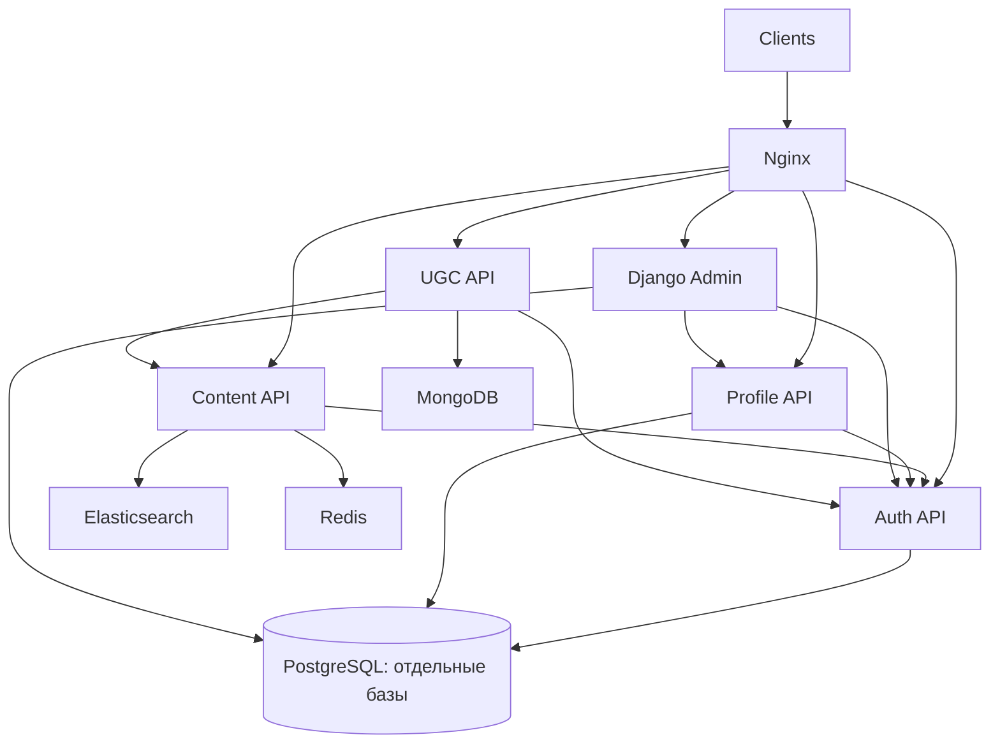

# Movies Backend

Монорепозиторий backend-сервисов онлайн-кинотеатра. Проект объединяет API
контента, аутентификацию, персональные профили, админ-панель, сбор событий,
пользовательский контент, уведомления и два ETL-процесса.

## Сервисы

| Compose service | Назначение | Основные зависимости |
| --- | --- | --- |
| `content-service` | фильмы, жанры, персоны и поиск | Elasticsearch, Redis, Auth Service |
| `auth-service` | пользователи, JWT, роли и permissions | PostgreSQL, Redis |
| `profile-service` | персональные профили и аудит | PostgreSQL, Auth Service |
| `admin-service` | Django Admin для контента и просмотра профилей | PostgreSQL, Auth и Profile Services |
| `content-etl` | PostgreSQL → Elasticsearch | PostgreSQL, Elasticsearch, Redis |
| `events-service` | приём пользовательских событий | Auth Service, Redis, Kafka |
| `events-etl` | Kafka → ClickHouse | Kafka, ClickHouse |
| `ugc-service` | закладки, оценки и рецензии | MongoDB, Redis, Auth и Content Services |
| `notification-service` | шаблоны, заявки на уведомления и рассылки | PostgreSQL, Kafka, Auth Service |
| `notification-worker`, `notification-sender` | получение заданий и отправка писем | PostgreSQL, Kafka, SMTP, Auth и Profile Services |

Подробности находятся в [обзоре сервисов](services/README.md) и README каждого
сервиса: [Content](services/content_service/README.md),
[Auth](services/auth_service/README.md),
[Profile](services/profile_service/README.md),
[Admin](services/admin_service/README.md),
[Content ETL](services/content_etl/README.md),
[Events](services/events_service/README.md),
[Events ETL](services/events_etl/README.md),
[UGC](services/ugc_service/README.md),
[Notification](services/notification_service/README.md) и
[Notification Worker](services/notification_worker/README.md).

## Архитектура

Основные связи API контента и пользовательских данных:



Auth отвечает за учётные записи и права, Profile — за ФИО, телефон и согласие
на маркетинговые сообщения, UGC — за закладки, оценки и рецензии.
Сервисы используют общий UUID пользователя. Персональные данные профиля
хранятся в зашифрованном виде в отдельной базе PostgreSQL; чтение профилей
сотрудниками доступно через API и Django Admin с правом `profiles:read`.

Content ETL переносит контент из PostgreSQL в Elasticsearch. Events Service
принимает события через Nginx и публикует их в Kafka, а Events ETL загружает
их в ClickHouse. Notification Service принимает заявки через Nginx,
сохраняет их в PostgreSQL и передаёт задания через Kafka. Notification Worker
получает email из Auth, имя и фамилию из Profile и отправляет письма через SMTP.

Nginx публикует основной HTTP-вход на `127.0.0.1:8000`. HTTP-сервисы
передают `X-Request-ID`; OpenTelemetry traces отправляются в Jaeger.

Логи всех Compose-контейнеров собираются цепочкой Filebeat → Logstash →
Elasticsearch и отображаются в Kibana. Ошибки каждого Python-сервиса и ETL
могут отправляться в Sentry по настроенному `SENTRY_DSN`.

## Быстрый запуск

### 1. Создать конфигурационные файлы

Из корня репозитория создайте отсутствующие `.env` из примеров.
Существующие настройки сохраняются:

```bash
for service in \
  admin_service \
  auth_service \
  content_etl \
  content_service \
  events_etl \
  events_service \
  notification_service \
  notification_worker \
  profile_service \
  ugc_service
do
  if [ ! -f "services/${service}/.env" ]; then
    cp \
      "services/${service}/.env.example" \
      "services/${service}/.env"
  fi
done
```

Перед запуском проверьте следующие значения:

- `JWT_SECRET_KEY` должен совпадать в Auth и Content Services; UGC Service
  проверяет токены через Auth Service и собственного ключа подписи не хранит;
- `SUPERUSER_PASSWORD` в Auth Service не должен оставаться `generate_me`;
- настройки `theatre-db` должны совпадать в Admin Service и Content ETL;
- `CLICKHOUSE_PASSWORD` должен совпадать у ClickHouse и Events ETL;
- данные MongoDB из UGC `.env` должны соответствовать `mongodb` в Compose.

Параметры межсервисного доступа должны совпадать:

| Параметр | Соответствующий параметр |
| --- | --- |
| `INTERNAL_TOKEN` в Notification Service | `NOTIFICATION_API_TOKEN` в Auth |
| `INTERNAL_TOKEN` в Notification Worker | `NOTIFICATION_WORKER_TOKEN` в Auth |
| `PROFILE_TOKEN` в Notification Worker | `NOTIFICATION_TOKEN` в Profile |
| `MIGRATION_TOKEN` в Profile | `PROFILE_MIGRATION_TOKEN` в Auth |

Для хранения персональных данных в Profile задаются `ENCRYPTION_KEYS` и
`PHONE_INDEX_KEY`, для хранения серверных Auth-сессий в Admin —
`ADMIN_TOKEN_KEY`. Значения `generate_me` в примерах необходимо заменить;
уже настроенные ключи сохраняйте. Формат ключей и порядок их смены описаны
в [README Profile Service](services/profile_service/README.md#защита-и-ключи).
При `PROFILE_NAMES_EXTERNAL=true` Auth хранит учётные данные, а ФИО
создаются и изменяются через Profile API.

Для учебного локального окружения MongoDB использует пользователя `ugc_user`
и пароль `ugc_password`, заданные в `docker-compose.yml`. MongoDB запускается
как одновузловой replica set `rs0`, а сервис `mongodb-init` автоматически
инициализирует его для поддержки транзакций UGC Service.

### 2. Установить Sentry

Этот шаг нужен для сбора ошибок в локальном Sentry. При пустом `SENTRY_DSN`
в конфигурации сервисов основной проект может работать без него.

Self-hosted Sentry запускается отдельным официальным Docker Compose-стеком.
Это необходимо, поскольку современные версии Sentry зависят от собственного
набора сервисов: PostgreSQL, Redis, Kafka, ClickHouse, Snuba, Relay и фоновых
consumer-процессов. Каталог с этим стеком генерируется установщиком и не
хранится в репозитории.

При первой настройке выполните:

```bash
make sentry-install
```

Команда клонирует зафиксированную в `Makefile` версию официального репозитория
`getsentry/self-hosted` в `infrastructure/sentry-self-hosted` и запускает её
установщик. Установка может занять продолжительное время и потребует загрузки
большого количества Docker-образов.

Во время установки можно отказаться от отправки телеметрии Sentry. На запрос
о создании пользователя следует ответить `Y` и создать локальную учётную
запись администратора.

Если установка была прервана, продолжите её без повторного клонирования:

```bash
cd infrastructure/sentry-self-hosted
./install.sh
cd ../..
```

### 3. Запустить систему

Основной проект запускается из корня репозитория:

```bash
docker compose up -d
docker compose ps
```

После изменений исходного кода, зависимостей или Dockerfile пересоберите
образы и запустите контейнеры:

```bash
docker compose build
docker compose up -d
```

Если используется установленный Sentry, запустите его командой
`make sentry-up`. Для запуска обоих уже установленных стеков также доступна
команда:

```bash
make up
```

Sentry и основной проект являются разными Compose-проектами, но управляются
из корня репозитория командами `make`.

Первый запуск может занять несколько минут из-за Elasticsearch, Kafka и
ClickHouse. Sentry также может некоторое время возвращать `502 Bad Gateway`,
пока внутренний сервис `web` не станет готов.

### 4. Создать суперпользователя приложения

Если суперпользователь ещё не создан, после готовности Auth выполните:

```bash
docker compose exec auth-service \
  python -m src.commands.create_superuser
```

Логин и пароль задаются параметрами `SUPERUSER_LOGIN` и `SUPERUSER_PASSWORD`
в `services/auth_service/.env`. Эти же учётные данные используются для входа
в Django Admin.

## Адреса

| Компонент | URL |
| --- | --- |
| Nginx | `http://127.0.0.1:8000` |
| Content Swagger | `http://127.0.0.1:8000/api/openapi` |
| Auth Swagger | `http://127.0.0.1:8000/docs` |
| Profile Swagger | `http://127.0.0.1:8000/profiles/docs` |
| Profile health/readiness | `http://127.0.0.1:8000/profiles/health`, `/profiles/ready` |
| Django Admin | `http://127.0.0.1:8000/admin/` |
| Профили в Django Admin | `http://127.0.0.1:8000/admin/profiles/` |
| UGC Swagger | `http://127.0.0.1:8000/ugc/docs` |
| UGC health/readiness | `http://127.0.0.1:8000/ugc/health`, `/ugc/ready` |
| Notification Swagger | `http://127.0.0.1:8000/notifications/docs` |
| Notification health/readiness | `http://127.0.0.1:8000/notifications/health`, `/notifications/ready` |
| Mailpit | `http://127.0.0.1:8025` |
| Jaeger | `http://127.0.0.1:16686` |
| Kibana | `http://127.0.0.1:5601` |
| Sentry | `http://127.0.0.1:9000` |
| Events ETL metrics | `http://127.0.0.1:9100/metrics` |
| Elasticsearch | `http://127.0.0.1:9200` |
| ClickHouse HTTP | `http://127.0.0.1:8123` |
| MongoDB | `mongodb://127.0.0.1:27017` |

UGC API также маршрутизируется через Nginx по префиксам
`/api/v1/bookmarks`, `/api/v1/ratings` и `/api/v1/reviews`. Events API
доступен по `POST /api/v1/events`.

Profile API доступен по префиксу `/api/v1/profiles`, Notification API —
по `/api/v1/notifications`. Для работы с собственным профилем используется
Bearer access-токен Auth. Чтение чужих профилей требует `profiles:read`
или статуса суперпользователя; управление контентом в Django Admin доступно
суперпользователям.

## Проверки качества

Установить инструменты разработки:

```bash
python -m pip install -r requirements-dev.txt
```

Локальные проверки:

```bash
ruff format --check .
ruff check .
radon mi services -s
```

Mypy запускается отдельно для каждого сервиса с его рабочим каталогом и
`MYPYPATH`. GitHub Actions запускает Ruff один раз, а проверку совместимости,
mypy и функциональные тесты сервисов, в которых они есть, — для Python 3.10,
3.11 и 3.12.

Актуальный разбор Maintainability Index находится в
[`docs/CODE_MAINTAINABILITY.md`](docs/CODE_MAINTAINABILITY.md).

## Функциональные тесты

Функциональные тесты Auth, Content и Profile Services используют собственные
Docker Compose окружения. Например, тесты Auth запускаются так:

```bash
cd services/auth_service/tests/functional
cp .env.example .env
docker compose -p movies-auth-tests up --build \
  --abort-on-container-exit \
  --exit-code-from tests \
  tests
docker compose -p movies-auth-tests down -v --remove-orphans
```

Для Content Service дополнительно нужен файл
`services/content_service/.env`, созданный из `.env.example`.

Команды и особенности остальных наборов описаны в README
[Content](services/content_service/README.md) и
[Profile](services/profile_service/README.md#проверки).

В CI все три набора запускаются на Python 3.10, 3.11 и 3.12.
Отдельная задача проверяет интеграции Auth, UGC, Notification Worker и
Django Admin с профилями.

## Наблюдаемость

Kibana показывает централизованные логи Nginx, приложений, ETL и хранилищ:

```text
http://127.0.0.1:5601
```

После первого запуска создайте data view `logs-*` с полем времени
`@timestamp`. Подробная инструкция находится в
[`infrastructure/elk/README.md`](infrastructure/elk/README.md).

Для ошибок приложений в Python-компонентах подключён Sentry SDK.
Он включается непустым `SENTRY_DSN` в `.env` конкретного сервиса.

После первого запуска откройте `http://127.0.0.1:9000`, создайте проект и
скопируйте его обычный DSN. Поскольку приложения и Sentry работают в разных
Compose-сетях, в сервисных `.env` необходимо заменить `127.0.0.1` в DSN на
`host.docker.internal`:

```env
SENTRY_DSN=http://PUBLIC_KEY@host.docker.internal:9000/PROJECT_ID
SENTRY_ENVIRONMENT=local
SENTRY_RELEASE=service_name@1.0.0
SENTRY_TRACES_SAMPLE_RATE=0.0
SENTRY_PROFILES_SAMPLE_RATE=0.0
```

`127.0.0.1` внутри контейнера указывает на сам контейнер, тогда как
`host.docker.internal` позволяет обратиться к опубликованному на компьютере
порту Sentry. Если `SENTRY_DSN` пуст, SDK отключается, поэтому основной проект
и CI могут работать без запущенного Sentry.

После изменения `.env` пересоздайте нужный сервис, например:

```bash
docker compose up -d --force-recreate ugc-service
```

Self-hosted Sentry ресурсоёмок. Для одновременного запуска Sentry,
Elasticsearch и остальных компонентов рекомендуется выделить Docker Desktop
не менее 12 GB памяти. Код завершения контейнера `137` вместе с
`OOMKilled=true` означает, что Docker не хватило выделенной оперативной памяти.
Предупреждения о запуске отдельных образов `linux/amd64` на Apple Silicon
допустимы: такие контейнеры выполняются через эмуляцию.

Обычный просмотр stdout/stderr остаётся доступен:

```bash
docker compose logs -f \
  nginx \
  auth-service \
  profile-service \
  content-service \
  events-service \
  events-etl \
  ugc-service
```

Jaeger принимает OTLP/gRPC на внутреннем порту `4317` и публикует UI на
`16686`.

## Остановка

Остановить основной проект и Sentry, сохранив данные:

```bash
make down
```

Остановить только основной проект:

```bash
docker compose down
```

Остановить только Sentry:

```bash
make sentry-down
```

Удалить контейнеры и named volumes основного проекта:

```bash
docker compose down -v --remove-orphans
```

Эта команда не удаляет данные отдельного Sentry-стека.

## Уведомления

`notification_service` и `notification_worker` обеспечивают защищённый API,
шаблоны, рассылки, transactional outbox, передачу заданий через Kafka,
отправку через SMTP, сохраняемые повторы и возврат результатов доставки.
Email получателя загружается из Auth, имя и фамилия — из Profile.
В локальном окружении письма доступны в Mailpit.
[Запуск, гарантии, проверки и текущие ограничения](services/notification_service/README.md).
Готовые тестовые настройки приведены в `.env.example` каждого сервиса.
