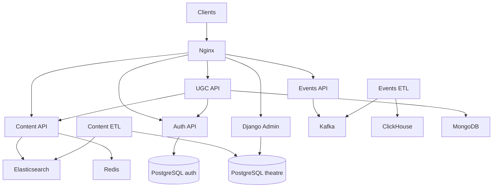

# Movies Backend

Монорепозиторий backend-сервисов онлайн-кинотеатра. Проект объединяет API
контента, аутентификацию, админ-панель, сбор событий, пользовательский контент
и два ETL-процесса.

## Сервисы

| Compose service | Назначение | Основные зависимости |
| --- | --- | --- |
| `content-service` | фильмы, жанры, персоны и поиск | Elasticsearch, Redis, Auth Service |
| `auth-service` | пользователи, JWT, роли и permissions | PostgreSQL, Redis |
| `admin-service` | Django Admin для контента | PostgreSQL, Auth Service |
| `content-etl` | PostgreSQL → Elasticsearch | PostgreSQL, Elasticsearch, Redis |
| `events-service` | приём пользовательских событий | Auth Service, Redis, Kafka |
| `events-etl` | Kafka → ClickHouse | Kafka, ClickHouse |
| `ugc-service` | закладки, оценки и рецензии | MongoDB, Redis, Auth и Content Services |

Подробности находятся в [обзоре сервисов](services/README.md) и README каждого
сервиса.

## Архитектура



Nginx публикует основной HTTP-вход на `127.0.0.1:8000`. HTTP-сервисы
передают `X-Request-ID`; OpenTelemetry traces отправляются в Jaeger.

Логи всех Compose-контейнеров собираются цепочкой Filebeat → Logstash →
Elasticsearch и отображаются в Kibana. Ошибки каждого Python-сервиса и ETL
могут отправляться в Sentry по настроенному `SENTRY_DSN`.

## Быстрый запуск

### 1. Создать конфигурационные файлы

Из корня репозитория:

```bash
for service in \
  admin_service \
  auth_service \
  content_etl \
  content_service \
  events_etl \
  events_service \
  ugc_service
do
  cp \
    "services/${service}/.env.example" \
    "services/${service}/.env"
done
```

Перед запуском проверьте следующие значения:

- `JWT_SECRET_KEY` должен совпадать в Auth, Content и UGC Services;
- `SUPERUSER_PASSWORD` в Auth Service не должен оставаться `generate_me`;
- настройки `theatre-db` должны совпадать в Admin Service и Content ETL;
- `CLICKHOUSE_PASSWORD` должен совпадать у ClickHouse и Events ETL;
- данные MongoDB из UGC `.env` должны соответствовать `mongodb` в Compose.

Для учебного локального окружения MongoDB использует пользователя `ugc_user`
и пароль `ugc_password`, заданные в `docker-compose.yml`.

### 2. Установить Sentry

Self-hosted Sentry запускается отдельным официальным Docker Compose-стеком.
Это необходимо, поскольку современные версии Sentry зависят от собственного
набора сервисов: PostgreSQL, Redis, Kafka, ClickHouse, Snuba, Relay и фоновых
consumer-процессов. Каталог с этим стеком генерируется установщиком и не
хранится в репозитории.

При первой настройке выполните:

```bash
make sentry-install
```

Команда клонирует зафиксированную в `Makefile` версию официального репозитория
`getsentry/self-hosted` в `infrastructure/sentry-self-hosted` и запускает её
установщик. Установка может занять продолжительное время и потребует загрузки
большого количества Docker-образов.

Во время установки можно отказаться от отправки телеметрии Sentry. На запрос
о создании пользователя следует ответить `Y` и создать локальную учётную
запись администратора.

Если установка была прервана, продолжите её без повторного клонирования:

```bash
cd infrastructure/sentry-self-hosted
./install.sh
cd ../..
```

### 3. Запустить систему

При первом запуске или после изменения Dockerfile запустите Sentry и соберите
основной проект:

```bash
make sentry-up
docker compose up -d --build
docker compose ps
```

Для последующих запусков обоих уже установленных стеков достаточно:

```bash
make up
```

Sentry и основной проект являются разными Compose-проектами, но управляются
из корня репозитория командами `make`.

Первый запуск может занять несколько минут из-за Elasticsearch, Kafka и
ClickHouse. Sentry также может некоторое время возвращать `502 Bad Gateway`,
пока внутренний сервис `web` не станет готов.

### 4. Создать суперпользователя приложения

```bash
docker compose exec auth-service \
  python -m src.commands.create_superuser
```

## Адреса

| Компонент | URL |
| --- | --- |
| Nginx | `http://127.0.0.1:8000` |
| Content Swagger | `http://127.0.0.1:8000/api/openapi` |
| Auth Swagger | `http://127.0.0.1:8000/docs` |
| Django Admin | `http://127.0.0.1:8000/admin/` |
| UGC Swagger | `http://127.0.0.1:8000/ugc/docs` |
| UGC health/readiness | `http://127.0.0.1:8000/ugc/health`, `/ugc/ready` |
| Jaeger | `http://127.0.0.1:16686` |
| Kibana | `http://127.0.0.1:5601` |
| Sentry | `http://127.0.0.1:9000` |
| Events ETL metrics | `http://127.0.0.1:9100/metrics` |
| Elasticsearch | `http://127.0.0.1:9200` |
| ClickHouse HTTP | `http://127.0.0.1:8123` |
| MongoDB | `mongodb://127.0.0.1:27017` |

UGC API также маршрутизируется через Nginx по префиксам
`/api/v1/bookmarks`, `/api/v1/ratings` и `/api/v1/reviews`. Events API
доступен по `POST /api/v1/events`.

## Проверки качества

Установить инструменты разработки:

```bash
python -m pip install -r requirements-dev.txt
```

Локальные проверки:

```bash
ruff format --check .
ruff check .
radon mi services -s
```

Mypy запускается отдельно для каждого сервиса с его рабочим каталогом и
`MYPYPATH`. GitHub Actions запускает Ruff один раз, а проверку совместимости,
mypy и функциональные тесты сервисов, в которых они есть, — для Python 3.10,
3.11 и 3.12.

Актуальный разбор Maintainability Index находится в
[`docs/CODE_MAINTAINABILITY.md`](docs/CODE_MAINTAINABILITY.md).

## Функциональные тесты

Функциональные тесты сейчас есть у Auth Service и Content Service. Каждый
набор использует собственное изолированное Docker Compose окружение.

```bash
cd services/auth_service/tests/functional
cp .env.example .env
docker compose up --build \
  --abort-on-container-exit \
  --exit-code-from tests \
  tests
docker compose down -v --remove-orphans
```

Для Content Service дополнительно нужен файл
`services/content_service/.env`, созданный из `.env.example`.

В CI оба набора запускаются на Python 3.10, 3.11 и 3.12.

## Наблюдаемость

Kibana показывает централизованные логи Nginx, приложений, ETL и хранилищ:

```text
http://127.0.0.1:5601
```

После первого запуска создайте data view `logs-*` с полем времени
`@timestamp`. Подробная инструкция находится в
[`infrastructure/elk/README.md`](infrastructure/elk/README.md).

Для ошибок приложений во всех семи Python-компонентах подключён Sentry SDK.
Он включается непустым `SENTRY_DSN` в `.env` конкретного сервиса.

После первого запуска откройте `http://127.0.0.1:9000`, создайте проект и
скопируйте его обычный DSN. Поскольку приложения и Sentry работают в разных
Compose-сетях, в сервисных `.env` необходимо заменить `127.0.0.1` в DSN на
`host.docker.internal`:

```env
SENTRY_DSN=http://PUBLIC_KEY@host.docker.internal:9000/PROJECT_ID
SENTRY_ENVIRONMENT=local
SENTRY_RELEASE=service_name@1.0.0
SENTRY_TRACES_SAMPLE_RATE=0.0
SENTRY_PROFILES_SAMPLE_RATE=0.0
```

`127.0.0.1` внутри контейнера указывает на сам контейнер, тогда как
`host.docker.internal` позволяет обратиться к опубликованному на компьютере
порту Sentry. Если `SENTRY_DSN` пуст, SDK отключается, поэтому основной проект
и CI могут работать без запущенного Sentry.

После изменения `.env` пересоздайте нужный сервис, например:

```bash
docker compose up -d --force-recreate ugc-service
```

Self-hosted Sentry ресурсоёмок. Для одновременного запуска Sentry,
Elasticsearch и остальных компонентов рекомендуется выделить Docker Desktop
не менее 12 GB памяти. Код завершения контейнера `137` вместе с
`OOMKilled=true` означает, что Docker не хватило выделенной оперативной памяти.
Предупреждения о запуске отдельных образов `linux/amd64` на Apple Silicon
допустимы: такие контейнеры выполняются через эмуляцию.

Обычный просмотр stdout/stderr остаётся доступен:

```bash
docker compose logs -f \
  nginx \
  auth-service \
  content-service \
  events-service \
  events-etl \
  ugc-service
```

Jaeger принимает OTLP/gRPC на внутреннем порту `4317` и публикует UI на
`16686`.

## Остановка

Остановить основной проект и Sentry, сохранив данные:

```bash
make down
```

Остановить только основной проект:

```bash
docker compose down
```

Остановить только Sentry:

```bash
make sentry-down
```

Удалить контейнеры и named volumes основного проекта:

```bash
docker compose down -v --remove-orphans
```

Эта команда не удаляет данные отдельного Sentry-стека.